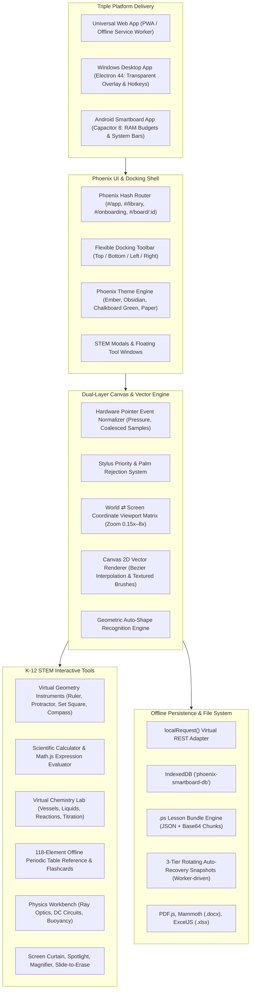
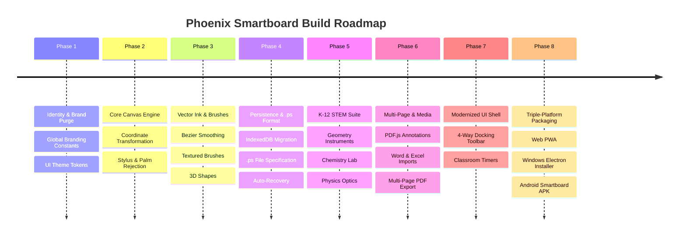

# Phoenix-Smartboard: Complete Implementation & Rebranding Master Plan

> [!IMPORTANT]
> **Project Specification Summary:**
> - **Product Name:** **Phoenix Smartboard**
> - **Package Identifier:** `phoenix-smartboard` (`com.phoenix.smartboard`)
> - **Native File Extension:** `.ps` (`application/vnd.phoenix-smartboard+json`)
> - **Target Platforms:** **Web App (PWA)**, **Windows Desktop (Electron)**, **Android Smartboard (Capacitor)**
> - **Curriculum Suite:** **Full K-12 STEM Suite** (Interactive Chemistry Lab, 118-Element Periodic Table, Physics Ray Optics & Circuits, Virtual Geometry Instruments, Scientific Calculator, Presentation Aids)
> - **Branding Philosophy:** 100% clean, independent codebase with zero legacy vendor leftovers.

---

## 1. System Architecture Diagram



---

## 2. Complete Rebranding & Purge Checklist

To ensure **Phoenix-Smartboard** contains no trace of the original project, the following replacements will be executed across all files:

| Target Domain | Original Legacy Value | New Phoenix Smartboard Value |
| :--- | :--- | :--- |
| **Product Display Name** | *(Legacy Name)* | **Phoenix Smartboard** |
| **Package Name** | *(Legacy Package)* | `phoenix-smartboard` |
| **App Bundle ID** | *(Legacy App ID)* | `com.phoenix.smartboard` |
| **Native File Extension** | *(Legacy Extension)* | **`.ps`** |
| **MIME Type** | *(Legacy MIME Type)* | `application/vnd.phoenix-smartboard+json` |
| **IndexedDB Database** | *(Legacy DB)* | `phoenix-smartboard-db` |
| **LocalStorage Keys** | `legacy-*` | `phoenix-*` |
| **Vendor CSS/Theme** | *(Legacy Themes)* | `phoenix-classic.css`, `phoenix-backgrounds.ts` |
| **Default Accent Color** | `#526677` | `#e63946` (Phoenix Crimson) |
| **Developer Credits / URLs** | *(Previous Owner / Handles)* | Clean open-source metadata under Phoenix Smartboard |
| **Splash / Tagline** | *(Legacy Tagline)* | `"Ignite your classroom. Your lesson, your way."` |

---

## 3. Core Engine Architecture

### A. Viewport & Coordinate Space
The canvas operates in a continuous, double-precision Cartesian coordinate space:
- **World Space Coordinates:**
  $$\begin{pmatrix} X_w \\ Y_w \end{pmatrix} = \frac{1}{\text{scale}} \begin{pmatrix} X_s \\ Y_s \end{pmatrix} - \begin{pmatrix} T_x \\ T_y \end{pmatrix}$$
- **Screen Space Coordinates:**
  $$\begin{pmatrix} X_s \\ Y_s \end{pmatrix} = \left( \begin{pmatrix} X_w \\ Y_w \end{pmatrix} + \begin{pmatrix} T_x \\ T_y \end{pmatrix} \right) \times \text{scale}$$
- **Scale constraints:** Clamped strictly between $0.15\times$ and $8.0\times$ with smooth pinch-to-zoom centering.

### B. Pointer Event Normalization & Stylus Priority
- **Hardware Stylus Tracking:** Leverages `event.getCoalescedEvents()` to capture 240Hz sampling rates on interactive touchboards without dropped points.
- **Stylus Pressure Interpolation:** Points store normalized pressure $p \in [0.0, 1.0]$. The stroke engine calculates variable stroke width using the `perfect-freehand` algorithm.
- **Palm Rejection & Touch Arbitration:**
  - `touchMode === "reject"`: Touches from fingers or palms are ignored while writing with an active stylus.
  - `touchMode === "pan"`: Stylus writes ink; finger touches pan or zoom the viewport.
  - `touchMode === "palm-erase"`: Large contact diameter ($> 28\text{px}$) switches automatically to eraser mode.

### C. Vector Stroke & Brush Physics
- **Pen & Marker:** Quadratic Bezier smoothing with midpoints between consecutive samples.
- **Calligraphy / Chinese Ink:** Dynamic angle calculations where stroke width varies based on pen trajectory heading.
- **Textured Chalk & Crayon:** Multi-pass alpha-blended grain masks.
- **Laser Pointer:** High-visibility glowing beam with exponential temporal decay:
  $$\alpha(t) = 1.0 - \left( \frac{t - t_{\text{created}}}{t_{\text{lifetime}}} \right)^2$$
  Automatically cleared and refreshed via `requestAnimationFrame`.

---

## 4. Full K-12 STEM Classroom Suite Specification

### A. Mathematics Suite
1. **Virtual Geometry Instruments**:
   - **Ruler:** Draggable and rotatable with precise millimeter and inch markings calibrated via `calibrationPxPerMm`. Snaps pointer input directly along the active edge to guarantee perfectly straight lines.
   - **Protractor:** Semi-circular and full 360-degree modes with an interactive angle ray display, showing degrees and radians live.
   - **Set Squares:** 45°/45°/90° and 30°/60°/90° transparent acrylic instruments with edge tracing.
   - **Compass:** Needle point anchors to world coordinates while pencil leg sweeps smooth circular arcs directly into board vector strokes.
2. **Scientific & Graphing Calculator**:
   - Powered by `mathjs` with dual Basic and Scientific layouts.
   - Trig modes: Degree (`DEG`) and Radian (`RAD`).
   - Evaluates functions, square roots, powers, logs, and factorials.
   - One-click insertion of formatted math formulas directly onto the board.
3. **Handwriting Equation Recognizer**:
   - Canvas stroke input box recognizing handwritten fractions, exponents, and variables, rendering clean LaTeX output onto the canvas.

### B. Virtual Chemistry Laboratory
1. **Interactive Glassware**:
   - Scalable 2D vector apparatus: Beakers, Erlenmeyer flasks, graduated cylinders, test tubes, burettes, and Bunsen burners.
2. **Liquid Engine & Titration**:
   - Dynamic fill level, meniscus curvature, and fluid color.
   - Live reagent mixing calculations ($C_1 V_1 + C_2 V_2 = C_f V_f$).
   - Acid-Base indicators: Realistic color transitions (e.g. colorless to vivid pink with phenolphthalein in $NaOH$).
3. **118-Element Offline Periodic Table**:
   - Interactive grid categorized into alkali metals, halogens, noble gases, etc.
   - Detailed modal with atomic number, atomic mass, electronegativity, and electron configuration.
   - "Insert Card" button that places a clean vector element card on the whiteboard.

### C. Physics Workbench
1. **Ray Optics Sandbox**:
   - Convex and concave thin-lens ray tracing ($1/f = 1/d_o + 1/d_i$).
   - Focal points, parallel rays, and center rays showing real and virtual image formation.
2. **DC Circuit Builder**:
   - Batteries, series/parallel resistors, switches, and light bulbs with live current ($I = V/R$) readouts.
3. **Buoyancy & Hydrostatics Tank**:
   - Archimedes' principle simulation with selectable fluids (Water, Oil, Mercury, Honey) and customizable object densities.

### D. Teaching Presentation Suite
1. **Screen Curtain:** 4-edge draggable opaque shade for step-by-step reveal of exam questions.
2. **Spotlight:** Adjustable circular or rectangular highlight beam that dims the surrounding board.
3. **Screen Magnifier:** High-detail 2x/4x magnification loupe.
4. **Slide to Erase:** Full board clear with accidental-press protection slider.
5. **Classroom Timers:** Big-digit countdown timer with alert sound, precision stopwatch, and analog clock.


---

## 5. Persistence, File System & `.ps` Format

### A. The Native `.ps` File Format
The `.ps` file is an uncompressed, human-readable UTF-8 JSON package (Version 1):

```json
{
  "format": "phoenix-smartboard",
  "version": 1,
  "generator": "Phoenix Smartboard v1.0.0",
  "exportedAt": "2026-10-19T18:50:00.000Z",
  "notebook": {
    "id": "uuid-v4",
    "title": "Kinematics & Optics Grade 11",
    "subject": "Physics",
    "coverColor": "#e63946",
    "pageCount": 3
  },
  "pages": [
    {
      "id": "uuid-v4",
      "position": 0,
      "background": "#1A4331",
      "pattern": "grid",
      "objects": [
        {
          "id": "obj-1",
          "kind": "stroke",
          "tool": "pen",
          "color": "#ffffff",
          "width": 4,
          "points": [{ "x": 100, "y": 200, "p": 0.5 }]
        }
      ],
      "media": []
    }
  ],
  "assets": [
    {
      "id": "asset-1",
      "name": "diagram.png",
      "mimeType": "image/png",
      "dataBase64": "iVBORw0KGgoAAAANSUhEUgAA..."
    }
  ]
}
```

> [!TIP]
> To ensure teachers can open older files, Phoenix Smartboard will include an internal converter that can import `.ps` and `.enb` files, automatically converting them into standard `.ps` format without exposing old branding.

### B. Offline IndexedDB Structure (`phoenix-smartboard-db`)
- Store **`profile`**: Teacher preferences, UI layout, watermark, custom pens, calibration factor.
- Store **`notebooks`**: List of all lessons with titles, subjects, timestamps.
- Store **`pages`**: Individual board pages indexed by `notebookId`.
- Store **`assets`**: Embedded images, PDFs, Word docs, audio clips stored as native `Blob`s.

---

## 6. Triple-Platform Implementation Strategy

### 1. Web Application & PWA
- Deployed as a static application (zero server maintenance).
- Service Worker caching via `vite-plugin-pwa` with offline fallback.
- Storage persistence request via `navigator.storage.persist()`.

### 2. Windows Desktop App (Electron)
- **Transparent Desktop Annotation Mode:**
  - Frameless, transparent BrowserWindow covering the whole display (`transparent: true, frame: false, alwaysOnTop: true`).
  - Floating dock with click-through toggle (`setIgnoreMouseEvents(true, { forward: true })`).
  - Allows drawing and highlighting directly over PowerPoint presentations, YouTube, or web browsers.
- **Local Disk Sync:** Automatic mirror backups saved directly to the user's `Documents/Phoenix-Smartboard/` directory.

### 3. Android Smartboard App (Capacitor)
- **RAM Performance Budgets:**
  - `2 GB Budget`: Conservative canvas buffer size, disposable asset cache for entry-level boards.
  - `4 GB Budget`: Standard classroom panel setting with high-res thumbnails.
  - `8 GB+ Budget`: Full-resolution 4K canvas rendering with multi-document caching.
- **Interactive Panel Features:**
  - Overlay permission (`SYSTEM_ALERT_WINDOW`) for system-wide floating pen toolbar.
  - Keep-Screen-On wakelock during classes.
  - Immersive full-screen mode hiding Android navigation and status bars.

---

## 7. Phased Execution Roadmap



### Detailed Phase Breakdown

#### Phase 1: Identity & Brand Scaffolding
- [ ] Establish `src/config/branding.ts` as the single source of truth for:
  - `APP_NAME = "Phoenix Smartboard"`
  - `FILE_EXTENSION = ".ps"`
  - `MIME_TYPE = "application/vnd.phoenix-smartboard+json"`
  - `DB_NAME = "phoenix-smartboard-db"`
- [ ] Purge and replace all occurrences of previous project names and owner handles.
- [ ] Design fresh Phoenix brand assets: App icons, favicons, vector logo, and splash screen graphics.

#### Phase 2: Core Vector Canvas Engine
- [ ] Implement robust `World ⇄ Screen` transformation matrix supporting $0.15\times - 8.0\times$ zoom and panning.
- [ ] Connect `pointerdown`, `pointermove`, `pointerup` with `getCoalescedEvents()`.
- [ ] Implement hardware stylus priority and palm rejection logic.

#### Phase 3: Vector Ink, Custom Brushes & 3D Shapes
- [ ] Integrate quadratic Bezier midpoint curve smoothing.
- [ ] Build brush shaders: Pen, Highlighter, Marker, Calligraphy, Chalk, and Laser Decay.
- [ ] Build 3D solid wireframe geometry renderer with interactive yaw/pitch/roll 3D rotation.

#### Phase 4: Persistence & `.ps` Format
- [ ] Initialize `phoenix-smartboard-db` in IndexedDB.
- [ ] Implement `.ps` bundle import/export engine with Base64 asset encoding.
- [ ] Implement background 3-tier rotating auto-recovery snapshots.
- [ ] Add silent file converter for backward compatibility.

#### Phase 5: K-12 STEM Classroom Suite
- [ ] Build Virtual Geometry Instruments (Ruler with edge snapping, Protractor, Set Square, Compass).
- [ ] Integrate `mathjs` Scientific Calculator and Handwriting Equation Recognizer.
- [ ] Build Interactive Chemistry Lab (Flasks, beakers, titration color changes, dynamic liquid levels).
- [ ] Implement 118-Element Offline Periodic Table with element card generator.
- [ ] Build Physics Ray Optics & DC Circuit simulations.

#### Phase 6: Multi-Page Document Pipeline
- [ ] Multi-page slide tray with live thumbnail rendering and drag-and-drop reordering.
- [ ] PDF document importer and page-by-page annotator (PDF.js).
- [ ] Word (`.docx`) and Spreadsheet (`.xlsx`) live whiteboard rendering.
- [ ] Export engine for `.ps`, multi-page PDF, and PNG images.

#### Phase 7: Modern UI & Presentation Tools
- [ ] 4-way dockable toolbar (Top, Bottom, Left, Right).
- [ ] Classroom presentation overlays: Screen Curtain, Spotlight, Magnifier, Slide-to-Erase.
- [ ] Classroom Countdown Timer, Stopwatch, and Analog Clock.


#### Phase 8: Triple-Platform Builds & Verification
- [ ] **Web:** PWA configuration, offline Service Worker, Lighthouse performance audits.
- [ ] **Windows Desktop:** Electron build with transparent desktop annotation overlay and NSIS installer.
- [ ] **Android Smartboard:** Capacitor configuration, large-screen memory profiles (2GB/4GB/8GB), and APK package.
