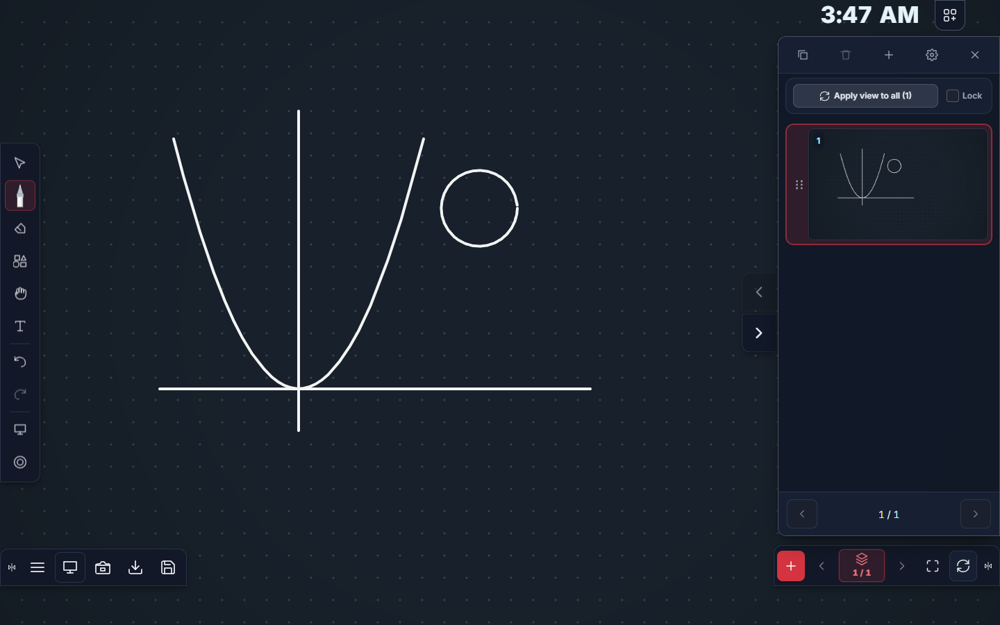
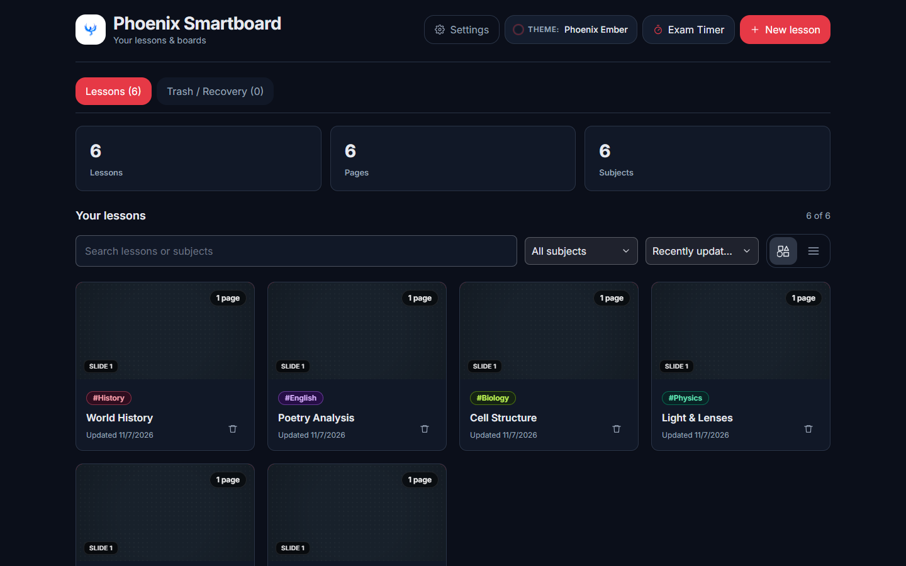
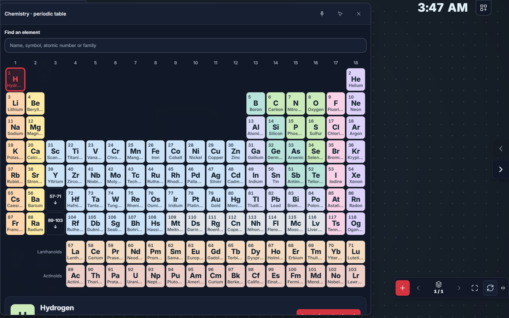
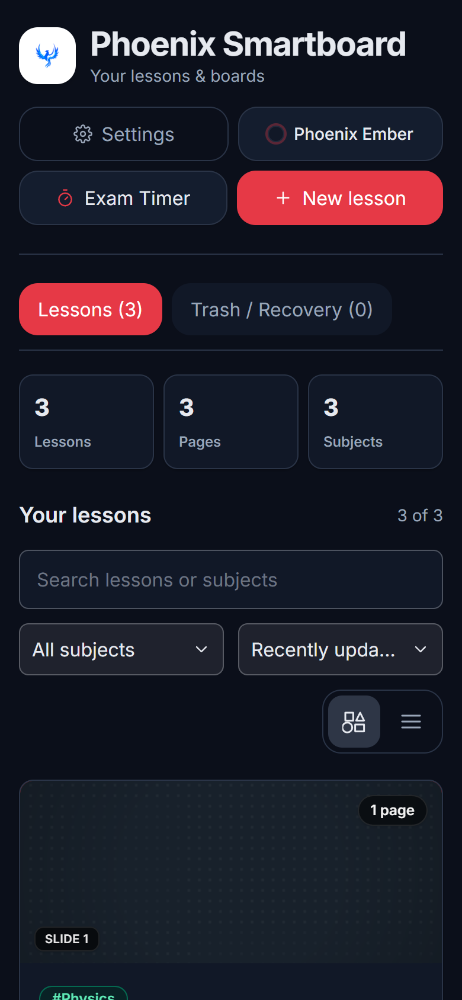

<div align="center">


# Phoenix Smartboard

### The offline teaching board for interactive classroom panels, PCs and Android.

Write, teach and explain with natural ink, real math and science tools, and lessons that stay on your device.

[](LICENSE)
[](tsconfig.json)
[](https://react.dev)
[](https://vite.dev)
[](https://www.electronjs.org)
[](https://capacitorjs.com)
[](#privacy-by-design)

[Features](#features) · [Screenshots](#screenshots) · [Get started](#get-started) · [Platforms](#platforms) · [Architecture](#architecture) · [Docs](#documentation)

<br>



</div>

---

## Why Phoenix Smartboard

- **Built for the front of the room.** Large touch targets, a toolbar you can reach from either side, an *Interface size* setting for 4K panels, and pen, touch and palm handling tuned for interactive displays.
- **Works with no internet.** No account, no login, no subscription. It installs as a web app, a Windows app or an Android app, and keeps working offline.
- **Your lessons stay yours.** Everything is stored on the device. No analytics, telemetry or trackers. Lessons export to an open, documented file format.
- **Real teaching tools, not stickers.** Geometry instruments you can draw along, a graphing calculator and equation solver, a periodic table, and physics and chemistry experiments that calculate real results.

## Features

### ✍️ Board and ink
- Pressure-sensitive, smoothed ink with **8 pen types**: pen, pencil, paint brush, Chinese brush, crayon, highlighter, fading laser pointer and stamp pen.
- **Custom pens** from the Pen store: design your own and pick which ones appear in the pen menu.
- Smart shapes, text and sticky cards, and **3D solids** (cube, cuboid, pyramid, prism, cylinder, cone, sphere).
- Erase by ink, selection, object or everything; palm erasing; dual-nib mode for smartboard styluses (the thick nib writes in a second colour).
- Select, move, resize, rotate, lock, duplicate and group objects; pan and zoom freely.
- **Multi-page lessons** with a slide panel: drag to reorder, duplicate, and apply one view to every slide.

### 📐 Math
- **Geometry instruments**: ruler, protractor, set squares and compass that strokes snap to.
- **Graphs**: plot functions of *x* with ready-made presets.
- **Calculator** with an equation solver (quadratic, cubic, 2×2 and 3×3 linear systems), matrix determinant and inverse, number-base conversion, and unit conversion for speed, temperature, pressure and energy.

### 🧪 Science
- **Periodic table** of all 118 elements, searchable by name, symbol, number or family.
- **Chemistry**: virtual beakers, test tubes, flasks, cylinders, burettes, droppers, funnels and a Bunsen burner. Add water, HCl or NaOH, read the pH, switch indicators (universal, litmus, phenolphthalein) and pour between vessels. Includes a dilution calculator and a chemical equation balancer.
- **Physics**: a resistor circuit (series or parallel, switch open or closed), a thin-lens experiment showing real and virtual images, and a buoyancy and density tank.

### 🎓 Classroom tools
- Timer, stopwatch and clock, plus a full-screen **exam timer** with saved presets.
- Spotlight, magnifier, solution blind (reveal answers step by step), reference pin and screen capture.
- **Noise meter** that shows when the room gets too loud.
- **Lesson recorder** for screen and microphone.
- **Display annotation**: draw on top of other apps on Windows and Android.

### 📂 Lessons and files
- **Import** PDF, PowerPoint (`.pptx`), OpenDocument slides (`.odp`), Word (`.docx`), Excel (`.xlsx`), CSV and images. Slides and pages become board pages you can write on.
- Embed audio, video, YouTube and web links, and **editable worksheets** with formulas (`SUM`, `AVERAGE`, `MIN`, `MAX`, `COUNT`, `ROUND`).
- **Export** to PDF, PNG, print, the native `.ps` lesson format, or `.enb`.
- A searchable lesson library with subjects, sorting, grid and list views, and a trash you can restore from.

### 🎨 Make it yours
- Built-in themes: Phoenix Ember, Chalkboard Emerald, Obsidian Midnight, Oxford Navy, Nordic Slate, Sage Harmony, Warm Ivory and Paper Classic. Import and export your own `.ps-theme` packs.
- Board presets, background images, accent colour, app name, icon, watermark and a toolbar layout editor.
- English and বাংলা (Bengali) interface.

### 🛡️ Reliable in class
- Autosave a moment after every change, with a recovery journal for unfinished edits.
- Rotating snapshots every 30 seconds and before anything is deleted. A **Trash / Recovery** tab brings lessons back.
- Optional folder backups to a drive you choose, on desktop and Android.
- Memory budgets for 2 GB, 4 GB and 8 GB boards, so large PDFs stay responsive on entry-level panels.

### ♿ Accessible
- Keyboard-reachable controls, focus-trapped dialogs, labelled inputs and screen-reader announcements.
- Respects *reduced motion* and *reduced transparency*.
- Contrast-checked colour tokens. Text and accent colours adjust automatically for every theme.

## Screenshots

<table>
  <tr>
    <td width="50%"><br><sub><b>Lesson library</b>: subjects, search, sorting and recovery.</sub></td>
    <td width="50%"><br><sub><b>Periodic table</b>: all 118 elements, searchable.</sub></td>
  </tr>
  <tr>
    <td width="50%"><br><sub><b>Teaching board</b>: ink, slide panel and docked tools.</sub></td>
    <td width="50%" align="center"><br><sub><b>Phone layout</b>: the same app on a small screen.</sub></td>
  </tr>
</table>

## Get started

**Requirements:** [Node.js](https://nodejs.org) 22 or newer (CI uses Node 24) and npm.

```bash
git clone https://github.com/nafissami19/phoenix-smartboard.git
cd phoenix-smartboard
npm install
npm run dev
```

Open <http://127.0.0.1:5173>. The first launch walks you through a short setup.

### Scripts

| Command | What it does |
|---|---|
| `npm run dev` | Start the development server |
| `npm run build` | Type-check and build the production web app into `dist/` |
| `npm run preview` | Serve the production build locally |
| `npm test` | Run the unit tests |
| `npm run typecheck` | Type-check the whole project |
| `npm run desktop` | Run the Electron desktop app |
| `npm run desktop:build` | Build the Windows installer into `release/` |
| `npm run android:sync` | Build the web app and copy it into the Android project |
| `npm run android:build` | Build the Android APK |
| `npm run build:all` | Build web, Windows and Android |
| `npm run check:privacy` | Check the source for trackers and remote calls |
| `npm run check:release` | Run the pre-release checks |

## Platforms

| Platform | Runtime | Highlights |
|---|---|---|
| **Web / PWA** | Any modern browser | Installable, offline service worker, IndexedDB storage |
| **Windows** | Electron 44 | NSIS installer, display annotation over other apps, folder backups |
| **Android** | Capacitor 8 | Built for smartboards: memory budgets, immersive full screen, keep-screen-on, display annotation |

To build for Android, run `npm run android:sync`, then open `android/` in Android Studio, or run:

```bash
cd android
./gradlew assembleDebug
```

See [docs/PACKAGING.md](docs/PACKAGING.md) and [docs/RELEASING.md](docs/RELEASING.md) for signed release builds.

## Architecture

```
src/
├─ app/               Pages: library, onboarding, board/[id]
├─ components/        UI; board/ holds the toolbar, panels and teaching tools
├─ lib/               Drawing engine, storage, import/export, science and math logic
│  ├─ use-whiteboard.ts   Canvas ink, selection, pan/zoom, undo/redo
│  ├─ render.ts           Canvas renderer
│  ├─ local-store.ts      IndexedDB behind a small local REST-style API
│  └─ lesson-bundle.ts    .ps lesson import/export
├─ config/branding.ts Name, colours and file-format constants
desktop/              Electron main process, preload and display annotation
android/, native/     Capacitor Android project and native plugins
test/                 Unit tests (Node test runner) and browser tests (Playwright)
docs/                 Guides and format specs
```

| Layer | Technology |
|---|---|
| UI | React 19, TypeScript (strict), Tailwind CSS v4 design tokens, Inter Variable |
| Drawing | Canvas 2D, `perfect-freehand` |
| Storage | IndexedDB (`idb`) |
| Documents | PDF.js, jsPDF, Mammoth, ExcelJS, JSZip, html2canvas |
| Math | mathjs |
| Apps | Vite 8 + `vite-plugin-pwa`, Electron 44, Capacitor 8 |

### The `.ps` lesson format

Lessons save as `.ps` files (`application/vnd.phoenix-smartboard+json`): one portable, human-readable JSON file with every page, vector stroke, setting and embedded file. Imports are validated and size-limited. See the [format specification](docs/PS_FORMAT.md).

## Privacy by design

Phoenix Smartboard has no server. Lessons, settings and recordings stay on the device unless you export them. There are no analytics, ads or third-party trackers. `npm run check:privacy` checks for this in CI and before every release. The optional local assistant only talks to an endpoint you set up yourself and is off by default.

## Testing

```bash
npm run typecheck
npm test
npx playwright test
```

Unit tests cover geometry, ink, storage, import/export, recovery, colour contrast and the science and math logic. Playwright browser tests drive the real app.

## Documentation

| Guide | Topic |
|---|---|
| [Setup](docs/SETUP.md) | Installing and first run |
| [Smartboards](docs/SMARTBOARD.md) | Interactive panel setup and display options |
| [Backups](docs/BACKUPS.md) | Autosave, snapshots, recovery and folder backups |
| [Pens](docs/PENS.md) | Pen types and the Pen store |
| [Science tools](docs/SCIENCE_TOOLS.md) | Chemistry and physics tools |
| [Themes](docs/THEME_PACKS.md) | Creating and sharing theme packs |
| [Customization](docs/CUSTOMIZATION.md) | Branding a fork |
| [Control layouts](docs/CONTROL_LAYOUTS.md) | Rearranging the toolbar and docks |
| [Offline devices](docs/OFFLINE_DEVICE.md) | Running fully offline |
| [Roadmap](docs/ROADMAP.md) | What's next |

## Contributing

Contributions from teachers, developers and designers are welcome. Read [CONTRIBUTING.md](CONTRIBUTING.md) and the [Code of Conduct](CODE_OF_CONDUCT.md) first, and report security issues as described in [SECURITY.md](SECURITY.md).

## License

Phoenix Smartboard is released under the [MIT License](LICENSE). Third-party notices are listed in [THIRD_PARTY.md](THIRD_PARTY.md).
